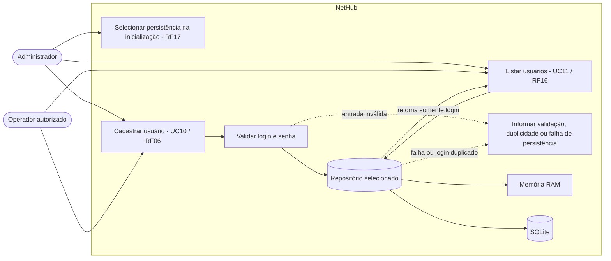

# 4. Casos de uso

## Casos detalhados disponíveis

- [UC01](uc01.md)
- [UC02](uc02.md)
- [UC03](uc03.md)
- [UC04](uc04.md)
- [UC05](uc05.md)
- [UC06](uc06.md)
- [UC07](uc07.md)
- [UC08](uc08.md)
- [UC09](uc09.md)
- [UC10](uc10.md) — Cadastrar usuário
- [UC11](uc11.md) — Listar usuários
- [UC12](uc12.md)
- [UC13](uc13.md)
- [UC14](uc14.md)

## Diagrama de casos de uso — gerenciamento de usuários

O diagrama cobre RF06, RF16 e RF17. O diagrama geral do produto ainda precisa ser elaborado e revisado pela equipe.

Os dois atores são perfis de uso previstos nos casos de uso; autenticação e autorização por perfil não fazem parte desta implementação.
