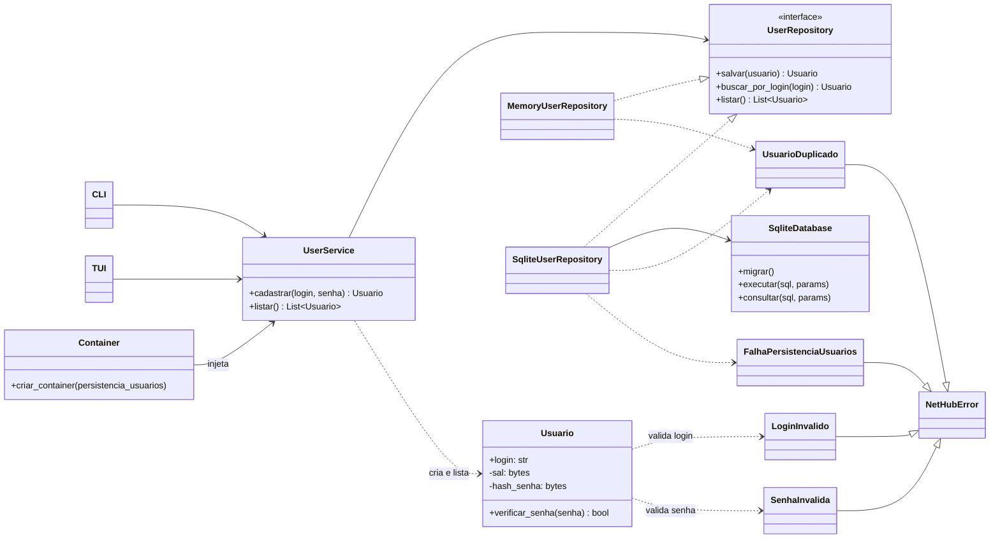

# 5. Análise

## Diagrama de classes

O diagrama de classes fornecido pela equipe está preservado como Mermaid em [`anexos/fontes/diagrama-de-classes-original.mmd`](03-elicitacao/anexos/fontes/diagrama-de-classes-original.mmd). Ele propõe camadas de apresentação, aplicação, domínio, portas e infraestrutura.

> O diagrama preservado abaixo é a fonte original da equipe. O modelo complementar de usuários, alinhado aos casos de uso e requisitos vigentes, está apresentado a seguir.

### Modelo de classes — gerenciamento de usuários

O `Container` escolhe `MemoryUserRepository` ou `SqliteUserRepository`. A entidade guarda o salt e o hash derivados, e a apresentação expõe somente o login.

```mermaid
classDiagram
    direction LR

    %% =========================================================
    %% APRESENTACAO
    %% =========================================================
    namespace Apresentacao {
        class NetHubApp {
            +run() void
        }
        class AppController {
            +handleInput(input) void
            +dispatch(useCase) Result
        }
        class View {
            <<abstract>>
            +render(model) void
        }
        class DiscoveryView
        class HostListView
        class HostDetailView
        class OperationView
        class WorkflowView
        class HistoryView
    }

    %% =========================================================
    %% APLICACAO (casos de uso)
    %% =========================================================
    namespace Aplicacao {
        class NetworkDiscoveryService {
            +discover(request) ScanResult
        }
        class InventoryService {
            +listHosts(filter) List~Host~
            +getHost(id) Host
        }
        class CapabilityService {
            +inspect(host) List~Capability~
            +isAuthorized(op, host) bool
        }
        class ActionCatalogService {
            +availableActions(host) List~Operation~
        }
        class RiskPolicyService {
            +assess(op, host) RiskLevel
            +confirm(op, host) bool
        }
        class RemoteCommandService {
            +execute(req) OperationResult
        }
        class HealthCheckService {
            +collect(host) HealthReport
        }
        class ServiceManagementService {
            +list(host) List~SystemdService~
            +restart(host, name) OperationResult
        }
        class FileTransferService {
            +upload(req) TransferResult
            +download(req) TransferResult
        }
        class WorkflowService {
            +simulate(id, host) DryRunReport
            +execute(id, host) WorkflowExecution
        }
        class PostActionValidator {
            +validate(op, host, result) ValidationResult
        }
        class AuditService {
            +record(op, host) AuditRecord
            +search(filter) List~AuditRecord~
        }
        class TagService {
            +assign(host, tag) void
        }
    }

    %% =========================================================
    %% DOMINIO
    %% =========================================================
    namespace Dominio {
        class Host {
            +String id
            +String ipAddress
            +String hostname
            +DateTime lastSeenAt
        }
        class NetworkPort {
            +int portNumber
            +String service
            +String state
        }
        class Capability {
            +String name
            +CapabilityState state
        }
        class HostTag {
            +String name
        }
        class Operation {
            +String id
            +String name
            +RiskLevel riskLevel
        }
        class OperationResult {
            +OperationStatus status
            +int exitCode
            +String stdout
        }
        class HealthReport {
            +List~Metric~ metrics
        }
        class Metric {
            +String name
            +float value
            +String status
        }
        class SystemdService {
            +String name
            +String activeState
        }
        class TransferResult {
            +OperationStatus status
            +bool integrityVerified
        }
        class Workflow {
            +String id
            +FailurePolicy failurePolicy
            +List~WorkflowStep~ steps
        }
        class WorkflowStep {
            +int order
            +String operationId
        }
        class WorkflowExecution {
            +OperationStatus status
            +List~OperationResult~ results
        }
        class DryRunReport {
            +List~String~ blockers
            +RiskLevel highestRisk
        }
        class AuditRecord {
            +String id
            +DateTime timestamp
            +RiskLevel riskLevel
            +OperationStatus status
        }
        class ValidationResult {
            +bool passed
        }
        class ScanResult {
            +bool complete
            +List~Host~ hosts
        }
        class RiskLevel {
            <<enum>>
            LOW
            MEDIUM
            HIGH
            CRITICAL
        }
        class CapabilityState {
            <<enum>>
            UNKNOWN
            AUTHENTICATED
            AUTHORIZED
        }
        class OperationStatus {
            <<enum>>
            SUCCESS
            FAILED
            CANCELLED
        }
        class FailurePolicy {
            <<enum>>
            STOP
            CONTINUE
            COMPENSATE
        }
    }

    %% =========================================================
    %% PORTAS (contratos)
    %% =========================================================
    namespace Portas {
        class INetworkScanner {
            <<interface>>
            +scan(req) ScanResult
        }
        class IHostRepository {
            <<interface>>
            +save(host) void
            +list() List~Host~
        }
        class IAuditRepository {
            <<interface>>
            +append(record) void
            +search(filter) List~AuditRecord~
        }
        class IRemoteExecutor {
            <<interface>>
            +execute(host, req) OperationResult
        }
        class IFileTransferClient {
            <<interface>>
            +transfer(host, req) TransferResult
        }
        class IWorkflowRepository {
            <<interface>>
            +find(id) Workflow
        }
    }

    %% =========================================================
    %% INFRAESTRUTURA (adapters)
    %% =========================================================
    namespace Infraestrutura {
        class NmapScanner {
            +scan(req) ScanResult
        }
        class OpenSSHExecutor {
            +execute(host, req) OperationResult
        }
        class SFTPAdapter {
            +transfer(host, req) TransferResult
        }
        class SQLiteRepositories {
            +initialize() void
        }
        class LocalProcessRunner {
            +run(cmd, timeout) ProcessResult
        }
    }

    %% =========================================================
    %% RELACIONAMENTOS ESSENCIAIS
    %% =========================================================

    %% Apresentacao
    NetHubApp *-- AppController
    AppController --> View
    AppController --> NetworkDiscoveryService
    AppController --> InventoryService
    AppController --> CapabilityService
    AppController --> ActionCatalogService
    AppController --> RemoteCommandService
    AppController --> HealthCheckService
    AppController --> ServiceManagementService
    AppController --> FileTransferService
    AppController --> WorkflowService
    AppController --> AuditService
    AppController --> TagService

    %% Aplicacao
    NetworkDiscoveryService --> INetworkScanner
    NetworkDiscoveryService --> IHostRepository
    InventoryService --> IHostRepository
    CapabilityService --> IRemoteExecutor
    ActionCatalogService --> CapabilityService
    ActionCatalogService --> RiskPolicyService
    RemoteCommandService --> IRemoteExecutor
    RemoteCommandService --> RiskPolicyService
    RemoteCommandService --> PostActionValidator
    RemoteCommandService --> AuditService
    HealthCheckService --> IRemoteExecutor
    ServiceManagementService --> IRemoteExecutor
    ServiceManagementService --> PostActionValidator
    FileTransferService --> IFileTransferClient
    FileTransferService --> PostActionValidator
    WorkflowService --> IWorkflowRepository
    WorkflowService --> AuditService
    PostActionValidator --> IRemoteExecutor
    AuditService --> IAuditRepository
    TagService --> IHostRepository

    %% Portas -> Adapters
    NmapScanner ..|> INetworkScanner
    OpenSSHExecutor ..|> IRemoteExecutor
    SFTPAdapter ..|> IFileTransferClient
    SQLiteRepositories ..|> IHostRepository
    SQLiteRepositories ..|> IAuditRepository
    SQLiteRepositories ..|> IWorkflowRepository

    NmapScanner --> LocalProcessRunner
    OpenSSHExecutor --> LocalProcessRunner
    SFTPAdapter --> LocalProcessRunner

    %% Dominio
    Host *-- NetworkPort
    Host *-- Capability
    Host "many" -- "many" HostTag
    Host "1" --> "many" AuditRecord

    Operation --> RiskLevel
    Capability --> CapabilityState
    OperationResult --> OperationStatus
    AuditRecord --> RiskLevel
    AuditRecord --> OperationStatus
    Workflow *-- WorkflowStep
    Workflow --> FailurePolicy
    WorkflowExecution *-- OperationResult
    DryRunReport --> RiskLevel
    HealthReport *-- Metric
    ScanResult *-- Host
```

