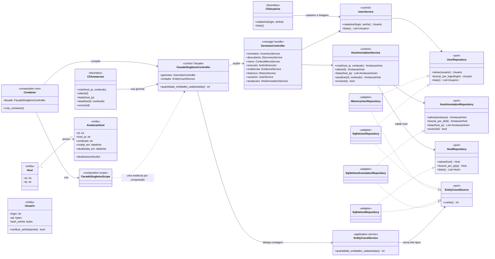

# Documento do Projeto — Versão 2

**Projeto:** NetHub  
**Disciplina:** Métodos e Projeto de Software  
**Versão:** 2.0  
**Data de consolidação:** 07/11/2026  
**Base de implementação:** tag `sprint-3` (`e55febc`)

## 1. Objetivo e escopo desta versão

Esta versão reúne as revisões registradas no repositório, três casos de uso relevantes, o diagrama geral de casos de uso, o modelo de classes de análise até a Sprint 3, os registros de revisão de código e uma avaliação do que está implementado.

O escopo documentado vem dos requisitos atuais e de suas fontes preservadas. O material legado tem divergências e a equipe registrou que não houve elicitação formal para a linha de base atual ([elicitação](03-elicitacao.md)). Requisitos que aparecem apenas como referências sem definição foram tratados como pendências, sem completar seu conteúdo por suposição.

## 2. Revisões incorporadas

- **Separação por responsabilidades:** domínio, aplicação, infraestrutura e apresentação, com dependências da aplicação voltadas a portas.
- **Cadastro e listagem de usuários (Sprints 1 e 2):** validação de login e senha, seleção entre memória e SQLite e proteção da senha com salt e hash; a apresentação não mostra dados de autenticação.
- **Revisão da Sprint 3:** anotações vinculadas a hosts, CRUD pela CLI e persistência SQLite; `FacadeSingletonController` reúne os gerentes e expõe a contagem de hosts, usuários e anotações.
- **SOLID e BCE:** o serviço de contagem foi separado da fachada; as classes relevantes foram identificadas como fronteira, controle, modelo, porta ou adaptador no [modelo de análise](05-analise.md).
- **Descoberta local:** a CLI pode detectar a rede da rota padrão, exibir o CIDR e solicitar autorização antes da varredura.
- **Documentação de execução:** README atualizado com exemplos da CLI e o comando para executar a suíte completa.

As mudanças da Sprint 3 e seus comentários por commit estão em [notas do release](releases/sprint-3.md). O histórico Git preserva os commits da implementação e da revisão `a52908e` (`refactor(sprint3): alinha fachada e contagem aos princípios SOLID`).

## 3. Três casos de uso relevantes

### UC01 — Descobrir dispositivos na rede

**Ator:** administrador ou operador.  
**Objetivo:** localizar hosts em uma rede autorizada e atualizar o inventário.

**Pré-condições:** o operador tem autorização para o escopo e o Nmap está disponível. O alvo pode ser informado ou detectado pela rota IPv4 padrão.

**Fluxo principal:** o operador informa ou confirma o CIDR; o sistema valida o escopo e a autorização; executa o Nmap; interpreta o resultado; apresenta os hosts encontrados e insere ou atualiza o inventário SQLite.

**Exceções:** alvo inválido, Nmap ausente ou com falha, XML inválido e varredura sem hosts são comunicados sem apresentar uma descoberta incompleta como concluída.

**Resultado:** hosts descobertos ficam disponíveis no inventário com os dados da descoberta. A execução é coberta por testes de aplicação e infraestrutura.

### UC03 — Executar comando remoto

**Ator:** administrador ou operador autorizado.  
**Objetivo:** executar um comando não interativo em um host autorizado via SSH.

**Pré-condições:** host conhecido e alcançável, autenticação SSH disponível e autorização para a operação.

**Fluxo principal:** o operador escolhe o host e informa o comando; o sistema apresenta o alvo e classifica o risco; solicita confirmação proporcional ao risco; executa com timeout; apresenta saída, erro e código de retorno; registra o resultado e as evidências.

**Exceções:** incompatibilidade da ação, falha de autenticação/conexão, timeout ou cancelamento. Falhas e cancelamentos não são reportados como sucesso e a tentativa é registrada quando aplicável.

**Resultado:** o resultado da operação fica disponível ao operador e no histórico de evidências. Este caso representa uma capacidade do produto cujo escopo é mais amplo que o CRUD introduzido na Sprint 3.

### UC15 — Manter anotações de hosts e consultar gerentes

**Ator:** administrador ou operador autorizado.  
**Objetivo:** registrar informação complementar associada a um host e permitir que clientes da aplicação acessem os gerentes por uma fachada.

**Pré-condições:** aplicação iniciada; para criar anotação, o host deve existir no inventário.

**Fluxo principal:** o operador cria uma anotação para o IP de um host; o serviço valida host e conteúdo; o repositório persiste a anotação e retorna seu identificador. O operador pode listar, consultar, atualizar ou excluir registros. Um cliente interno pode obter a fachada e solicitar a quantidade total de hosts, usuários e anotações.

**Exceções:** host inexistente, conteúdo vazio ou identificador não encontrado são tratados sem confirmar uma gravação inválida.

**Resultado:** anotações persistidas em SQLite ficam relacionadas ao host. A fachada expõe `quantidade_entidades_cadastradas()`, delegando a soma a `EntityCountService`.

As especificações completas estão em [UC01](04-casos-de-uso/uc01.md), [UC03](04-casos-de-uso/uc03.md) e [UC15](04-casos-de-uso/uc15.md).

## 4. Diagrama geral de casos de uso

O diagrama PlantUML separado em [`diagrama-casos-de-uso-v2.puml`](04-casos-de-uso/diagrama-casos-de-uso-v2.puml) reúne os requisitos funcionais definidos no baseline, as mudanças de gestão de usuários e da Sprint 3, e a mudança de CLI de anotações. O escopo inclui RF01–RF19 e RF29–RF32.

RF18 e RF19 vêm do arquivo-fonte legado preservado; ainda não foram migrados para specs OpenSpec. RF20–RF28 são citados em UC12–UC14, mas não possuem definições funcionais correspondentes localizadas no repositório. Não foram inventados no diagrama; precisam de reconciliação pela equipe. O diagrama de usuários anterior permanece disponível como histórico/documentação específica.

## 5. Diagrama de classes de análise até a Sprint 3

O modelo integrado abaixo representa os dois cadastros presentes nesta entrega: `Usuario` (criação e listagem) e `AnotacaoHost` (CRUD completo), além de `Host`, dos repositórios e da fachada Singleton. A fachada é singleton por escopo de composição e delega a contagem a um serviço próprio.

**Limite do modelo:** `Usuario` não oferece atualização nem exclusão no código atual. Portanto, o modelo documenta com precisão o cadastro e a listagem de usuários e o CRUD completo de anotações; não afirma CRUD completo para as duas entidades. Se o critério da disciplina exigir CRUD integral nas duas entidades, esse item ainda precisa de implementação.

## 6. Revisões de código registradas

O histórico e as notas por commit estão em [`releases/sprint-3.md`](releases/sprint-3.md). A revisão técnica identificável no código foi registrada no commit `a52908e`, que:

- extrai a contagem para `EntityCountService`, mantendo a fachada como ponto de acesso;
- agrupa os gerentes em `GerentesController`;
- limita a identidade Singleton ao escopo de uma composição da aplicação;
- mantém portas de contagem separadas das operações CRUD.

O registro comprova uma revisão/refatoração incorporada ao repositório. Não foi localizado no histórico desta cópia um relatório separado de revisão por pares nem um comentário de aprovação de PR para essa revisão; se “revisões enviadas” se referir a um artefato externo submetido ao professor, ele deve ser anexado pela equipe.

## 7. Implementação até a Sprint 3

**Resposta:** a implementação planejada e registrada para as Sprints 1, 2 e 3 está presente no repositório e a suíte atual passa. Isso não significa que todos os requisitos funcionais do escopo original do produto estejam implementados.

### Entregas implementadas

- **Sprints 1 e 2:** cadastro e listagem de usuários; persistência em memória ou SQLite; validação; senha solicitada sem eco e armazenada como hash com salt; cobertura de erros de persistência.
- **Sprint 3:** entidade de anotação relacionada a host; criar, consultar, listar, atualizar e excluir pela CLI; persistência SQLite; fachada singleton por composição; contagem de hosts, usuários e anotações; UC15 e diagrama de análise atualizados.
- **Validação executada nesta revisão:** `python3 -m unittest discover -v` — **65 testes aprovados**.

### Escopo que permanece parcial ou pendente

- `Usuario` tem cadastro e listagem, mas não operações de atualização e exclusão.
- RF18 (cadastrar host associado a usuário) não está implementado como esse fluxo; os hosts são registrados pela descoberta de rede.
- RF20–RF28 não têm especificações correspondentes no repositório, embora sejam citados em UC12–UC14.
- O diagrama geral cobre requisitos funcionais documentados, inclusive os itens sem implementação; presença no diagrama expressa escopo definido, não conclusão de implementação.
- Parte do produto original — como workflow, health check, gestão de serviços e transferência SFTP — não foi demonstrada como implementada pelas Sprints 1–3 desta entrega.

Assim, o resultado atende às funcionalidades específicas documentadas das Sprints 1–3, com a ressalva de que um pedido de “CRUD completo de duas entidades” não está integralmente satisfeito enquanto `Usuario` não tiver atualização e exclusão.

## 8. Referências do repositório

- [Entregas e checklist](00-entregas.md)
- [Requisitos OpenSpec](../openspec/specs/)
- [Casos de uso UC01–UC15](04-casos-de-uso/)
- [Análise e modelos](05-analise.md)
- [Notas e histórico comentado da Sprint 3](releases/sprint-3.md)
- [README e comandos de execução/teste](../README.md)
