# Documento do Projeto — Versão 2

**Projeto:** NetHub  
**Disciplina:** Métodos e Projeto de Software  
**Versão:** 2.1 
**Data de consolidação:** 26/11/2026 
**Base de implementação:** `main` (`c7d0f8e`); alterações da Sprint 5 presentes nesta cópia de trabalho, ainda sem commit ou PR

## 1. Objetivo e escopo desta versão

Esta versão reúne as revisões registradas no repositório, casos de uso relevantes, diagramas, os padrões aplicados até a Sprint 5 e uma avaliação do que está implementado.

O escopo documentado vem dos requisitos atuais e de suas fontes preservadas. O material legado tem divergências e a equipe registrou que não houve elicitação formal para a linha de base atual ([elicitação](03-elicitacao.md)). Requisitos que aparecem apenas como referências sem definição foram tratados como pendências, sem completar seu conteúdo por suposição.

## 2. Revisões incorporadas

- **Separação por responsabilidades:** domínio, aplicação, infraestrutura e apresentação, com dependências da aplicação voltadas a portas.
- **Cadastro e listagem de usuários (Sprints 1 e 2):** validação de login e senha, seleção entre memória e SQLite e proteção da senha com salt e hash; a apresentação não mostra dados de autenticação.
- **Revisão da Sprint 3:** anotações vinculadas a hosts, CRUD pela CLI e persistência SQLite; `FacadeSingletonController` reúne os gerentes e expõe a contagem de hosts, usuários e anotações.
- **SOLID e BCE:** o serviço de contagem foi separado da fachada; as classes relevantes foram identificadas como fronteira, controle, modelo, porta ou adaptador no [modelo de análise](05-analise.md).
- **Descoberta local:** a CLI pode detectar a rede da rota padrão, exibir o CIDR e solicitar autorização antes da varredura.
- **Documentação de execução:** README atualizado com exemplos da CLI e o comando para executar a suíte completa.
- **Main atualizada:** registro de tentativas de acesso, relatórios em texto/HTML/PDF, adaptador de logging e `RepositoryFactory`; o escopo de relatórios está especificado em [RF33](../openspec/specs/relatorios-de-acesso/spec.md) e [UC16](04-casos-de-uso/uc16.md).
- **Sprint 5 — Command e Memento:** operações de anotação passam por comandos da fachada; o snapshot Memento permite desfazer uma vez a atualização mais recente, inclusive entre execuções da CLI.

As mudanças da Sprint 3 e seus comentários por commit estão em [notas do release](releases/sprint-3.md). O histórico Git preserva os commits da implementação e da revisão `a52908e` (`refactor(sprint3): alinha fachada e contagem aos princípios SOLID`).

## 3. Casos de uso relevantes

### UC01 — Descobrir dispositivos na rede

**Ator:** administrador ou operador.  
**Objetivo:** localizar hosts em uma rede autorizada e atualizar o inventário.

**Pré-condições:** o operador tem autorização para o escopo e o Nmap está disponível. O alvo pode ser informado ou detectado pela rota IPv4 padrão.

**Fluxo principal:** o operador informa ou confirma o CIDR; o sistema valida o escopo e a autorização; executa o Nmap; interpreta o resultado; apresenta os hosts encontrados e insere ou atualiza o inventário SQLite.

**Exceções:** alvo inválido, Nmap ausente ou com falha, XML inválido e varredura sem hosts são comunicados sem apresentar uma descoberta incompleta como concluída.

**Resultado:** hosts descobertos ficam disponíveis no inventário com os dados da descoberta. A execução é coberta por testes de aplicação e infraestrutura.

### UC03 — Executar comando remoto

**Ator:** administrador ou operador autorizado.  
**Objetivo:** executar um comando não interativo em um host autorizado via SSH.

**Pré-condições:** host conhecido e alcançável, autenticação SSH disponível e autorização para a operação.

**Fluxo principal:** o operador escolhe o host e informa o comando; o sistema apresenta o alvo e classifica o risco; solicita confirmação proporcional ao risco; executa com timeout; apresenta saída, erro e código de retorno; registra o resultado e as evidências.

**Exceções:** incompatibilidade da ação, falha de autenticação/conexão, timeout ou cancelamento. Falhas e cancelamentos não são reportados como sucesso e a tentativa é registrada quando aplicável.

**Resultado:** o resultado da operação fica disponível ao operador e no histórico de evidências. Este caso representa uma capacidade do produto cujo escopo é mais amplo que o CRUD introduzido na Sprint 3.

### UC15 — Manter anotações de hosts e consultar gerentes

**Ator:** administrador ou operador autorizado.  
**Objetivo:** registrar informação complementar associada a um host e permitir que clientes da aplicação acessem os gerentes por uma fachada.

**Pré-condições:** aplicação iniciada; para criar anotação, o host deve existir no inventário.

**Fluxo principal:** o operador cria uma anotação para o IP de um host; o serviço valida host e conteúdo; o repositório persiste a anotação e retorna seu identificador. O operador pode listar, consultar, atualizar ou excluir registros. Um cliente interno pode obter a fachada e solicitar a quantidade total de hosts, usuários e anotações.

**Exceções:** host inexistente, conteúdo vazio ou identificador não encontrado são tratados sem confirmar uma gravação inválida.

**Resultado:** anotações persistidas em SQLite ficam relacionadas ao host. A fachada expõe `quantidade_entidades_cadastradas()`, delegando a soma a `EntityCountService`.

Os casos detalhados estão em [UC01](04-casos-de-uso/uc01.md), [UC03](04-casos-de-uso/uc03.md), [UC15](04-casos-de-uso/uc15.md) e [UC16](04-casos-de-uso/uc16.md).

### UC16 — Consultar tentativas e exportar relatório de acessos

O operador exporta estatísticas agrupadas por login em HTML ou PDF pela CLI; clientes internos também podem solicitar texto. O relatório contém total de tentativas, sucessos, falhas e último acesso, sem dados de credenciais. O detalhamento está em [UC16](04-casos-de-uso/uc16.md) e [RF33](../openspec/specs/relatorios-de-acesso/spec.md).

## 4. Diagrama geral de casos de uso

O diagrama PlantUML separado em [`diagrama-casos-de-uso-v2.puml`](04-casos-de-uso/diagrama-casos-de-uso-v2.puml) reúne os requisitos funcionais definidos no baseline e as mudanças das Sprints 1–4. O escopo inclui RF01–RF19 e RF29–RF33.

RF18 e RF19 vêm do arquivo-fonte legado preservado; ainda não foram migrados para specs OpenSpec. RF20–RF28 são citados em UC12–UC14, mas não possuem definições funcionais correspondentes localizadas no repositório. Não foram inventados no diagrama; precisam de reconciliação pela equipe. O diagrama de usuários anterior permanece disponível como histórico/documentação específica.

## 5. Diagrama de classes de análise atualizado até a Sprint 5

O modelo integrado abaixo representa os dois cadastros presentes nesta entrega: `Usuario` (criação e listagem) e `AnotacaoHost` (CRUD completo), além de `Host`, dos repositórios, da fachada Singleton, dos comandos e do memento. A fachada é singleton por escopo de composição e delega a contagem a um serviço próprio. O diagrama de análise detalhado está em [05-analise.md](05-analise.md#modelo-de-classes-atualizado--sprint-5).

```mermaid
classDiagram
    direction LR
    class CliUsuarios {
        <<boundary>>
        +cadastrar(login, senha)
        +listar()
    }
    class CliAnotacoes {
        <<boundary>>
        +criar(host_ip, conteudo)
        +obter(id)
        +listar(host_ip)
        +atualizar(id, conteudo)
        +excluir(id)
    }
    class FacadeSingletonController {
        <<control / facade>>
        +gerentes: GerentesController
        -contador: EntityCountService
        +criar_anotacao(host_ip, conteudo)
        +obter_anotacao(id)
        +listar_anotacoes(host_ip)
        +atualizar_anotacao(id, conteudo)
        +excluir_anotacao(id)
        +desfazer_ultima_atualizacao_anotacao()
        +quantidade_entidades_cadastradas() int
    }
    class FacadeSingletonScope {
        <<composition scope>>
    }
    class Container {
        <<composition root>>
        +facade: FacadeSingletonController
        +criar_container()
    }
    class GerentesController {
        <<manager bundle>>
        +inventario: InventoryService
        +descoberta: DiscoveryService
        +menu: ContextMenuService
        +executor: ActionExecutor
        +evidencias: EvidenceService
        +historico: HistoryService
        +usuarios: UserService
        +anotacoes: HostAnnotationService
    }
    class EntityCountService {
        <<application service>>
        +quantidade_entidades_cadastradas() int
    }
    class EntityCountSource {
        <<port>>
        +contar() int
    }
    class RepositoryFactory {
        <<factory partial>>
        +criar() Repositories
        -_criar_usuarios() UserRepository
    }
    class Repositories {
        <<product family>>
        +hosts: HostRepository
        +evidencias: EvidenceRepository
        +usuarios: UserRepository
        +anotacoes: HostAnnotationRepository
        +acessos: UserAccessRepository
        +mementos_anotacao: AnnotationMementoRepository
    }
    class UserService {
        <<control>>
        +cadastrar(login, senha) Usuario
        +listar() List~Usuario~
    }
    class HostAnnotationService {
        <<control>>
        +criar(host_ip, conteudo) AnotacaoHost
        +obter(id) AnotacaoHost
        +listar(host_ip) List~AnotacaoHost~
        +atualizar(id, conteudo) AnotacaoHost
        +excluir(id) bool
        +desfazer_ultima_atualizacao() AnotacaoHost
    }
    class Command {
        <<interface>>
        +execute()
    }
    class CommandInvoker {
        +invoke(command)
    }
    class CreateAnnotationCommand
    class GetAnnotationCommand
    class ListAnnotationsCommand
    class UpdateAnnotationCommand
    class DeleteAnnotationCommand
    class UndoLastAnnotationUpdateCommand
    class AnnotationMementoRepository {
        <<port>>
        +salvar(memento)
        +obter_ultimo() MementoAnotacao
        +limpar()
    }
    class SqliteAnnotationMementoRepository {
        <<adapter>>
        +salvar(memento)
        +obter_ultimo() MementoAnotacao
        +limpar()
    }
    class UserRepository {
        <<port>>
        +salvar(usuario) Usuario
        +buscar_por_login(login) Usuario
        +listar() List~Usuario~
    }
    class HostRepository {
        <<port>>
        +salvar(host) Host
        +buscar_por_ip(ip) Host
        +listar() List~Host~
    }
    class HostAnnotationRepository {
        <<port>>
        +salvar(anotacao) AnotacaoHost
        +buscar_por_id(id) AnotacaoHost
        +listar(host_ip) List~AnotacaoHost~
        +excluir(id) bool
    }
    class MemoryUserRepository {
        <<adapter>>
    }
    class SqliteUserRepository {
        <<adapter>>
    }
    class SqliteHostRepository {
        <<adapter>>
    }
    class SqliteHostAnnotationRepository {
        <<adapter>>
    }
    class Host {
        <<entity>>
        +id: int
        +ip: str
    }
    class Usuario {
        <<entity>>
        +login: str
        -sal: bytes
        -hash_senha: bytes
        +verificar_senha(senha) bool
    }
    class AnotacaoHost {
        <<entity>>
        +id: int
        +host_ip: str
        +conteudo: str
        +criada_em: datetime
        +atualizada_em: datetime
        +atualizar(conteudo)
        +criar_memento() MementoAnotacao
        +restaurar(memento)
    }
    class MementoAnotacao {
        <<immutable snapshot>>
        +id: int
        +conteudo: str
        +atualizada_em: datetime
    }
    Command <|.. CreateAnnotationCommand
    Command <|.. GetAnnotationCommand
    Command <|.. ListAnnotationsCommand
    Command <|.. UpdateAnnotationCommand
    Command <|.. DeleteAnnotationCommand
    Command <|.. UndoLastAnnotationUpdateCommand
    Container --> FacadeSingletonScope : cria
    Container --> FacadeSingletonController : compõe
    Container --> RepositoryFactory : compõe repositórios
    RepositoryFactory --> Repositories : cria família
    CliUsuarios --> UserService : cadastro e listagem
    CliAnotacoes --> FacadeSingletonController : usa gerente
    FacadeSingletonScope ..> FacadeSingletonController : uma instância por composição
    FacadeSingletonController --> GerentesController : expõe
    FacadeSingletonController --> EntityCountService : delega contagem
    FacadeSingletonController --> CommandInvoker : executa
    CommandInvoker --> Command
    CreateAnnotationCommand --> HostAnnotationService
    GetAnnotationCommand --> HostAnnotationService
    ListAnnotationsCommand --> HostAnnotationService
    UpdateAnnotationCommand --> HostAnnotationService
    DeleteAnnotationCommand --> HostAnnotationService
    UndoLastAnnotationUpdateCommand --> HostAnnotationService
    GerentesController --> UserService
    GerentesController --> HostAnnotationService
    UserService --> UserRepository
    HostAnnotationService --> HostAnnotationRepository
    HostAnnotationService --> HostRepository : valida host
    HostAnnotationService --> AnnotationMementoRepository : guarda o último estado
    AnotacaoHost ..> MementoAnotacao : cria e restaura
    SqliteAnnotationMementoRepository ..|> AnnotationMementoRepository
    SqliteAnnotationMementoRepository --> MementoAnotacao : persiste snapshot único
    MemoryUserRepository ..|> UserRepository
    SqliteUserRepository ..|> UserRepository
    SqliteHostRepository ..|> HostRepository
    SqliteHostAnnotationRepository ..|> HostAnnotationRepository
    SqliteUserRepository ..|> EntityCountSource
    MemoryUserRepository ..|> EntityCountSource
    SqliteHostRepository ..|> EntityCountSource
    SqliteHostAnnotationRepository ..|> EntityCountSource
    EntityCountService --> EntityCountSource : soma três tipos
    Host "1" --> "0..*" AnotacaoHost : possui
```

**Limite do modelo:** `Usuario` não oferece atualização nem exclusão no código atual. Portanto, o modelo documenta com precisão o cadastro e a listagem de usuários e o CRUD completo de anotações; não afirma CRUD completo para as duas entidades.

## 6. Revisões de código registradas

O histórico e as notas por commit estão em [`releases/sprint-3.md`](releases/sprint-3.md). A revisão técnica identificável no código foi registrada no commit `a52908e`, que:

- extrai a contagem para `EntityCountService`, mantendo a fachada como ponto de acesso;
- agrupa os gerentes em `GerentesController`;
- limita a identidade Singleton ao escopo de uma composição da aplicação;
- mantém portas de contagem separadas das operações CRUD.

O registro comprova uma revisão/refatoração incorporada ao repositório. Não foi localizado no histórico desta cópia um relatório separado de revisão por pares nem um comentário de aprovação de PR para essa revisão; se “revisões enviadas” se referir a um artefato externo submetido ao professor, ele deve ser anexado pela equipe.

## Padrões encontrados nesta cópia

- **Facade:** `FacadeSingletonController` encaminha as operações CRUD de anotações e a contagem aos serviços de aplicação.
- **Singleton por composição (parcial):** há uma fachada por `FacadeSingletonScope`, vinculada ao ciclo de vida do container. Composições distintas podem ter fachadas diferentes; isso não implementa um Singleton global ao processo se esse for o critério da rubrica.
- **Repository:** as portas `HostRepository`, `EvidenceRepository`, `UserRepository` e `HostAnnotationRepository` são implementadas por adaptadores de persistência.
- **Abstract Factory (parcial):** `RepositoryFactory` monta um conjunto de repositórios e seleciona entre memória e SQLite apenas para usuários. Hosts, evidências, anotações, acessos e mementos continuam em SQLite; não há duas famílias completas de repositórios.
- **Adapter:** `NmapAdapter`, `SshExecutor` e `LinuxLocalNetworkDetector` traduzem interfaces de bibliotecas e do sistema operacional para as portas da aplicação.
- **Template Method:** `AccessReportTemplate` define o fluxo de geração; relatórios em texto, HTML e PDF implementam suas etapas.
- **Adapter de logging:** `PythonLoggingAdapter` adapta o logger padrão para `LoggerPort`.
- **Command:** `FacadeSingletonController` cria comandos para operações de anotação e os executa por `CommandInvoker`.
- **Memento:** `AnotacaoHost` cria snapshots imutáveis; o serviço e `SqliteAnnotationMementoRepository` guardam somente o anterior à última atualização, para um único desfazer.

O diagrama de arquitetura de [07-arquitetura/Diagram.md](07-arquitetura/Diagram.md) registra esses padrões e as classes de implementação incluídas na `main`.

## 7. Implementação até a Sprint 5

**Resposta:** a `main` em `c7d0f8e` contém as entregas das Sprints 1–4, incluindo registro e relatórios de acesso. Esta cópia de trabalho também contém a implementação da Tarefa 3.2 da Sprint 5, ainda sem commit ou PR de integração. Isso não significa que todos os requisitos funcionais do escopo original estejam implementados.

### Entregas implementadas

- **Sprints 1 e 2:** cadastro e listagem de usuários; persistência em memória ou SQLite; validação; senha solicitada sem eco e armazenada como hash com salt; cobertura de erros de persistência.
- **Sprint 3:** entidade de anotação relacionada a host; criar, consultar, listar, atualizar e excluir pela CLI; persistência SQLite; fachada singleton por composição; contagem de hosts, usuários e anotações; UC15 e diagrama de análise atualizados.
- **Sprint 4:** registro de tentativas de acesso, Abstract Factory de repositórios, adapter de logging e relatórios de acesso em texto, HTML e PDF. A seleção de persistência por factory ainda é parcial: apenas usuários alternam entre memória e SQLite.
- **Sprint 5 — Tarefa 3.2:** fachada executa comandos concretos; Memento restaura uma única vez o estado anterior à última atualização; CLI oferece `anotacoes desfazer`; diagrama e OpenSpec atualizados.
- **Validação executada nesta revisão:** `python3 -m unittest discover -v` — **81 testes aprovados**; `openspec validate --all` — **13 especificações válidas**.

### Escopo que permanece parcial ou pendente

- `Usuario` tem cadastro e listagem, mas não operações de atualização e exclusão.
- RF18 (cadastrar host associado a usuário) não está implementado como esse fluxo; os hosts são registrados pela descoberta de rede.
- RF20–RF28 não têm especificações correspondentes no repositório, embora sejam citados em UC12–UC14.
- O diagrama geral cobre requisitos funcionais documentados, inclusive os itens sem implementação; presença no diagrama expressa escopo definido, não conclusão de implementação.
- Parte do produto original — como workflow, health check, gestão de serviços e transferência SFTP — não foi demonstrada como implementada pelas Sprints 1–3 desta entrega.

Assim, a cópia de trabalho contém as funcionalidades documentadas das Sprints 1–5 (Tarefa 3.2), mas a parte da Sprint 5 ainda não foi integrada por PR. `Usuario` continua sem atualização e exclusão; portanto, um pedido de CRUD completo para duas entidades não está integralmente atendido.

## 8. Referências do repositório

- [Entregas e checklist](00-entregas.md)
- [Requisitos OpenSpec](../openspec/specs/)
- [Casos de uso UC01–UC16](04-casos-de-uso/)
- [UC16 e RF33 — relatórios de acesso](04-casos-de-uso/uc16.md)
- [Análise e modelos](05-analise.md)
- [Notas e histórico comentado da Sprint 3](releases/sprint-3.md)
- [README e comandos de execução/teste](../README.md)
